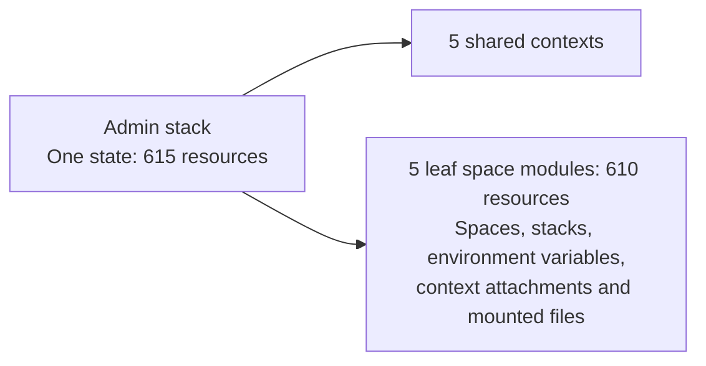
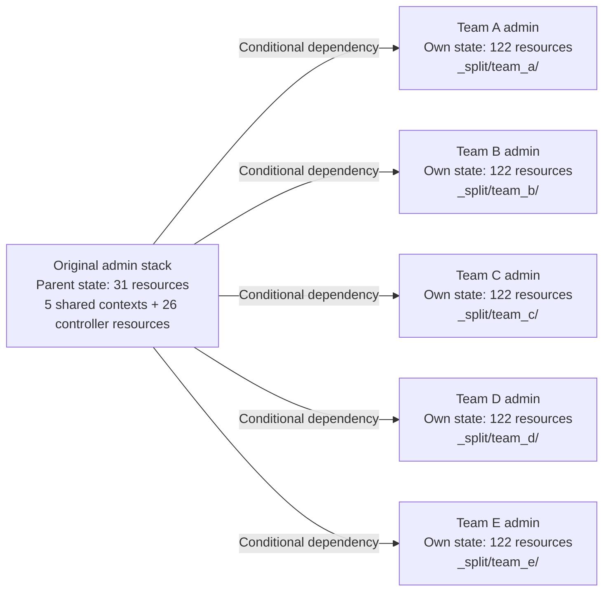

# Admin stack splitter

Split a **migration-kit / liftoff admin stack** into a parent and smaller child admins, using local preparation and a one-time API publish. The tool reads generated configuration, a matching state snapshot, and the existing admin stack's settings. It partitions local copies while preserving resource addresses and attributes.

Build from source with Go 1.27.3 or later:

```sh
git clone https://github.com/jnesspace/admin-stack-splitter.git
cd admin-stack-splitter
go build -o admin-splitter ./cmd/admin-splitter
./admin-splitter --help
```

Run all `admin-splitter` commands locally. Start with the [quickstart](docs/quickstart.md) for API credentials, state capture, version matching and preparation on your own workstation. The tool authenticates directly with Spacelift; no additional Spacelift CLI is needed. Actual plans and applies run in Spacelift.

Read the [cutover procedure](docs/cutover.md) before scheduling the change. Preparation produces a `CUTOVER.md` with your stack, worker pool, counts, child paths and state-file mount table. The default API path uploads the split in one local command, then leaves plan review and apply in Spacelift. The original manual procedure remains available.

Commands print a readable summary by default. Add `--json` to a command when scripting:

```sh
./admin-splitter inspect --state ./source/admin.tfstate --json
```

## Example: before and after

This example splits 615 existing resources across five leaf spaces. Live changes happen during publication and subsequent reviewed applies; `prepare` only creates local files.

### Before: one admin owns everything



A normal plan refreshes the whole admin state, even when an edit affects only one leaf space.

### After: the original admin manages five child admins



The original 615 resources keep their addresses and IDs, with exactly one state owner each. The parent adds 26 controller resources: five child stacks, their role and policy attachments, their dependencies and output references, and one shared push policy. The resulting states contain 641 resources in total. All admins use the original worker pool; a private pool stays private.

After each child's manual bootstrap, a tracked parent apply publishes a separate payload for each child. That payload contains the child's inputs and a digest of its configuration. A changed payload triggers that child; unchanged children are skipped. Multiple affected children can run in parallel when worker capacity is available. Each child still requires manual approval when its plan has changes.

For example, editing `_split/team_a/` changes only Team A's configuration digest. The parent applies that output change, Team A plans against its 122 resources, and Teams B–E are skipped. An edit to a shared input can trigger several children.

## Preview and safety checks

There is no separate `--dry-run` flag. The preview workflow is `inspect` followed by `prepare`:

| Command | Effect |
| --- | --- |
| `fetch` | Reads source settings and state into a new private directory |
| `inspect` | Prints state counts and proposed groups without writing files |
| `prepare` | Partitions local state copies, renders configuration and runs local initialization/validation |
| `check-source` | Compares a fresh state snapshot with the one recorded by preparation |
| `publish` | Previews by default; `--confirm` uploads split state/configuration and starts a proposed parent run |
| `verify-plan` | Checks a saved plan JSON against the allowed changes |

Only `publish --confirm` uploads state, changes stack settings and starts a run. No command applies a plan. Preparation retains the original snapshot, refuses existing output directories and checks that every original resource has exactly one state owner. `--validate=false` skips configuration validation; it is not a dry-run switch and its output cannot authorize controller creation.

A live OpenTofu plan still has to be produced on the correct stacks during cutover. Verify the actual plan that will be applied using the [cutover procedure](docs/cutover.md).

## Inherit the existing stack

Set `SPACELIFT_API_KEY_ID`, `SPACELIFT_API_KEY_SECRET` and `SPACELIFT_API_KEY_ENDPOINT` as described in the quickstart, then fetch your source stack:

```sh
./admin-splitter fetch --stack YOUR_ADMIN_STACK_ID --out ./source
```

This saves the current state and stack settings in a new private directory. An existing session token in `SPACELIFT_API_TOKEN` can be used instead of the API-key pair. The fetch command issues authentication and state-download requests; it does not change stack configuration or live state.

With the applied configuration in `./generated/` and the matching OpenTofu version installed, prepare from these saved inputs:

```sh
./admin-splitter prepare \
  --config ./generated \
  --state ./source/admin.tfstate \
  --source-stack ./source/source-stack.json \
  --out ./prepared
```

Children inherit the original worker pool, runner image, project root, space and same-space administrator role. API publication puts the parent and children in a new Spacelift-managed repository on `main`; the manual path retains the original VCS settings. **A private source pool stays private.** Missing pool metadata is an error; an explicitly public source stays public. Preparation with saved inputs makes no account requests; initialization may download providers.

If you already have a state snapshot, `prepare --stack YOUR_ADMIN_STACK_ID` can read the settings directly using the same credentials and endpoint. For account access through MCP, export [examples/source-stack.graphql](examples/source-stack.graphql) and supply it with `--source-stack`. MCP's `{"stack": ...}` and GraphQL's `{"data": {"stack": ...}}` envelopes are accepted.

The OpenTofu version comes from the state. Install that exact version or pass `--tool /path/to/tofu`. Existing provider requirements and lock files are preserved. The tool does not install or upgrade OpenTofu.

## Choose module boundaries

```sh
./admin-splitter inspect --config ./generated --state ./source/admin.tfstate
```

Each populated leaf space becomes a child by default. Shared ancestors stay in the parent. Review the remaining parent count: a single huge leaf or many root resources need a different split boundary.

For explicit groups, add `--layout choices.json` alongside the source-stack options:

```json
{
  "groups": [
    {"name": "team_a", "module": "module.organization.module.team_a"},
    {"name": "team_b", "module": "module.organization.module.team_b"}
  ]
}
```

Only `groups` and root input `variables` are accepted as choices. Runtime settings come from the source. Group names must be unique; `parent` is reserved. For manual integration work, [examples/layout.json](examples/layout.json) is a full layout and requires an explicit worker pool. Manual layouts do not discover source settings.

## Outputs and safeguards

```text
prepared/
  .gitignore                   # excludes private snapshots and logs
  prepare.json                 # source identity, counts, pool, validation
  CUTOVER.md                   # your split details, API steps and manual alternative
  repo/                        # publishable parent configuration
    _split/NAME/               # authoritative child configuration roots
  private/
    original.tfstate           # unchanged source backup
    states/parent.tfstate      # original lineage, selected resources removed
    states/NAME.tfstate         # distinct lineages, original addresses
```

The destination must be new and outside the source configuration. Directories use mode 700; files use mode 600. Source configuration and state remain unchanged. Publish **only `prepared/repo/`**.

Native `tofu state mv` operates on local copies without backend configuration. Checks account for each original instance exactly once and compare its address and attributes. Preparation runs `init -backend=false` and `validate` on every root. Require `complete: true` and `validated: true`; `--validate=false` is diagnostic and cannot authorize controller creation.

After cutover, edit child paths listed in `prepare.json`. Original subdirectories may remain as inactive copies. Do not run liftoff generation/publication over the split tree: it recreates the original single-admin wiring.

## Publish through the API

After preparation, run locally:

```sh
./admin-splitter publish --prepared ./prepared
./admin-splitter publish --prepared ./prepared --confirm
```

The first command checks current state and settings. Children use the same standard OpenTofu workflow representation as migration-kit. The second takes a lock, creates a new Spacelift-managed repository, uploads each child's state while creating its disabled stack, imports the reduced parent state, points the existing parent at the new repository, and starts a **proposed** parent plan. It keeps the parent ID and worker pool, pins the original OpenTofu version and clears old sparse-checkout paths so the parent can hash all child files. Automatic apply is off, and no apply is performed.

Open the returned run link. The parent plan must import the newly created child stacks and create only their controller wiring. Existing resources must have no changes. Review and apply that parent change in Spacelift, then enable and bootstrap each child. Follow the generated `CUTOVER.md` for the checks and expected resource counts.

State goes directly to Spacelift's signed state-upload endpoint. No state mount or plan-export hook is needed for this path. The API path requires a user session or personal API key with Space admin access; machine credentials cannot import parent state. It rejects source hooks and context attachments because those dependencies are not copied to children.

Publication saves its progress and original settings/state under `prepared/private/publish/`. It is a one-time operation: a second attempt is refused. A failed attempt requires reviewing that record before recovery; it never silently retries imports or rolls back ownership. Keep the private directory until the split has been verified.

### Optional local plan checks

`verify-plan` still accepts privately exported saved-plan JSON. It does not download plans. For an API publication, use its report, which records the exact child imports:

```sh
./admin-splitter verify-plan --plan parent-plan.json \
  --prepared ./prepared/private/publish/review.json --allow-controller-create

./admin-splitter verify-plan --plan child-plan.json \
  --prepared ./prepared/prepare.json
```

The JSON must describe the actual saved plan; state JSON is rejected. With `--prepared`, the OpenTofu version must match. The parent plan must contain exactly the recorded creates and imports, with no updates, deletes or replacements. Child bootstrap plans require zero managed-resource changes. Review output changes separately. For the manual cutover, use `prepare.json` for both commands.

## Supported input

- Current kit output: unindexed nested space modules, inherited context IDs, and `concat` / `merge` wiring.
- Standard OpenTofu admins. Settings discovery supports native repositories and default/custom GitHub integrations, with the kit's same-space space-admin role. Other VCS providers or custom permission scopes need a reviewed manual layout.
- Empty root provider configurations. Aliases, configured providers, explicit provider mappings, cross-module outputs, module dependencies and external assets require manual adaptation.
- Local dependencies must stay inside each selected subtree. Escaping sibling references, cycles, symlinks and hidden dependency directories fail before partitioning.
- Sensitive boundary inputs are refused. Only Terraform files and provider lock files are copied; backend/cloud blocks are removed.

Publication also requires a working `stateDownloadUrl` API for the source. In the November 2026 sandbox test, that endpoint rejected a native OpenTofu source despite external access being enabled; the migration-kit OpenTofu workflow under the Terraform vendor could download state. A download failure stops publication before writes. The splitter never changes the source vendor to work around it.

Source hooks, context attachments and cloud integrations are not cloned. Review customized runtime dependencies before handoff.

## Validation scope

Tests use generic configuration derived from migration-kit output and synthetic state. They verify partition ownership, IDs, attributes, shared inputs, source runtime settings and native configuration validation. They do not prove a customer-account zero-change plan.

A disposable sandbox rehearsal on 2026-11-04 split five built-in data resources into one parent resource and two resources per child. The parent applied two child imports and nine controller additions with zero existing-resource changes. Both child bootstrap plans had zero changes. A Team A-only edit ran Team A and skipped Team B. A final fresh publication also passed; sandbox stacks, controller resources and repositories were removed afterward.

## Source layout

- `cmd/admin-splitter/` starts the CLI.
- `internal/splitter/` contains command handling, API access, preparation and plan checks, with tests and generic fixtures.
- `docs/` contains the customer guides and embeds the cutover procedure.
- `examples/` contains a manual layout and a stack-settings query.

See [CONTRIBUTING.md](CONTRIBUTING.md) for build and test commands.

## Dependencies

HCL edits configuration syntax; cty evaluates expressions and renders typed values. License names were checked in dependency sources.

| Dependency | License |
| --- | --- |
| github.com/hashicorp/hcl/v2 | MPL-2.0 |
| github.com/zclconf/go-cty | MIT |
| github.com/agext/levenshtein | Apache-2.0 |
| github.com/apparentlymart/go-textseg/v15 | MIT |
| github.com/google/go-cmp | BSD-3-Clause |
| github.com/mitchellh/go-wordwrap | BSD-3-Clause |
| golang.org/x/mod | BSD-3-Clause |
| golang.org/x/sync | BSD-3-Clause |
| golang.org/x/text | BSD-3-Clause |
| golang.org/x/tools | BSD-3-Clause |
